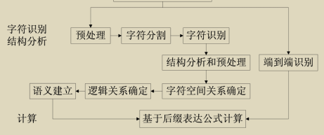
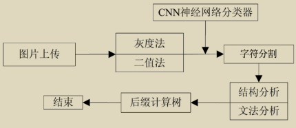

## 解决方法思路
目标是最大化预测词的概率

MyScript 模型类别，表达式正确识别  67.65%

## 方法移植
  方法关键点： 元数据字段 和 结构关系提取。

## 标注如何提高后续识别正确率
| 用法 | 能带来的帮助 | 条件 |
|---|---|---|
| 固定评测集 | 判断修改是否真正改善识别，及时发现退化 | 人工确认，训练时不能使用这部分答案 |
| 历史纠错与候选参考 | 为相似品类、字迹和常见错读提供参考 | 保存图片区域及纠错前后值，不能照搬历史斤数 |
| 微调小模型 | 让模型适应该业务的手写数字、单位和商品名称 | 有足够的“图片区域＋准确文字”训练样本 |

因此，“保存 JSON”本身不会提高识别能力，必须把数据接入评测、候选检索或训练流程。
优先方案是微调已有轻量文字识别模型，而非从零训练一个“图片直接输出五字段 JSON”的模型。训练数据至少需要：
- 准确的行或字段裁剪图；
- 对应的真实文字，尤其保留前导零、小数点和单位；
- 原始单据分组，避免同一张单的裁剪同时进入训练集和验收集；
- 不同字迹、新编码及困难图片。
“小”需要同时约束模型文件大小、运行依赖大小、CPU 耗时和内存。可以先将权重文件不超过约 20 MB 作为试验目标；

## paddle
用 Paddle”：结构服务正在运行，Paddle 已加载就绪。 不过刚才健康检查显示，该服务本次启动后的请求数为 0，说明尚未收到结构分析请求。加载就绪与业务识别实际调用是两回事。

目前项目将 Paddle 用作可选的版面、表格结构分析服务；handwriting 的主要识别仍调用腾讯 OCR 和 DeepSeek，没有直接使用 Paddle 作为专用手写行识别器。

值得利用的是：本机已经有 PP-OCRv5_mobile_rec。官方支持独立文字识别模块，它可以作为单行试验的起点；是否适合你的字迹，必须用真实裁剪图对照验证。
** 先拿现有 Paddle 识别模型测试单行，再完善标注、尝试微调；取得可重复的收益后，才接入 handwriting。 这样可以先确定问题来自识字、裁剪还是字段关联，避免训练了模型却没有解决主要错误。**

## 识别原理
同时还包含了符号的分割和分类等。
** 把 表达式计算 换成 单据字段提取和校对 **，该方法可以适用手写单据识别的场景。

算法

## 参考
数学公式识别和计算通常可分为三部分:字符识别、结构分析以及数学计算

