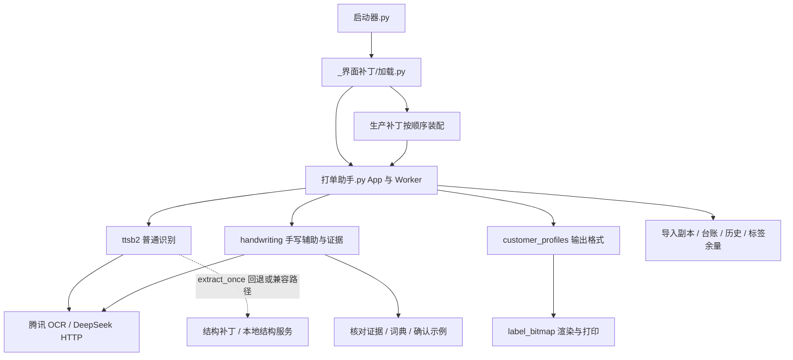

# 打单助手 V6 软件设计说明书

| 项目 | 内容 |
| --- | --- |
| 软件名称 | 打单助手 V6 |
| 文档版本 | V6.1（当前源码同步版） |
| 更新日期 | 2026-11-06 |
| 文档性质 | 软件设计与实际实现说明；供开发、维护及交付参考 |
| 适用基线 | 本项目根目录业务源码、生产 `_界面补丁/`、`handwriting/`、`_ppstructure/`、构建脚本与测试源码 |
| 平台 | Windows 桌面；Python + Tkinter；PyInstaller onedir 发布 |
| 版本说明 | 产品名称为 V6；现有 settings.json 的版本为 6，但 app_settings.py 的版本常量仍为 4.0、默认配置版本仍为 4，不能把这些值视为统一发布版本号 |

> 本文以函数体和生产加载链为依据。历史说明、代码注释、测试报告及构建目录中的旧副本不能替代当前实现。本文不表示现有 `dist/` 与源码完全一致，也不把接口返回成功等同于识别正确或实体标签已出纸。已发现的实现缺口单列于第 12 节。

## 目录

1. [范围与设计原则](#1-范围与设计原则)
2. [技术栈与系统结构](#2-技术栈与系统结构)
3. [启动与补丁装配](#3-启动与补丁装配)
4. [图片导入与普通识别](#4-图片导入与普通识别)
5. [手写辅助识别与核对学习](#5-手写辅助识别与核对学习)
6. [客户规则与核对界面](#6-客户规则与核对界面)
7. [标签渲染打印与周末模式](#7-标签渲染打印与周末模式)
8. [数据与配置设计](#8-数据与配置设计)
9. [外部接口与结构服务](#9-外部接口与结构服务)
10. [异常处理与诊断](#10-异常处理与诊断)
11. [运行构建与验证](#11-运行构建与验证)
12. [实现限制与待核验项](#12-实现限制与待核验项)
13. [源码索引与本次修订](#13-源码索引与本次修订)

## 1. 范围与设计原则

软件用于采购单图片识别、人工核对、客户输出格式转换及 40×30 mm 标签打印，兼有当天打单台账、会话内补打、标签余量估算、周末只写记录和手写核对学习能力。

当前主业务链为：

**导入图片 → 按图片选择识别通道 → 提取并核对明细 → 清单人工检查 → 按客户生成输出副本 → 打印或写记录。**

核心原则：

- 识别提示词统一，不按所选客户预设要识别哪些品类；不通过旧跳过规则删掉识别行。
- 原始识别字段、人工编辑及证据状态保存在记录中；客户品类别名、编码显示、备注处理主要作用于显示、预览和打印副本。
- 自动识别与交叉核对只能提供结果和疑点；人工仍须检查。当前打印入口不强制要求全部疑点已确认。
- 对有证据的数量、单位和品类进行裁决；证据不足时保留疑点，不能将“合计碰巧一致”当成所有字段都正确。
- 桌面主线程负责界面，后台线程负责识别与打印，队列传递完成、错误和进度。
- 配置、台账、导入副本与学习数据分别保存；更新程序时保留用户已有数据。

本文描述桌面生产链。`ttsb2.py` 的命令行批处理、`handwriting` 的独立实验接口、`设计和测试/` 的核验脚本不是桌面入口的等价替代。

## 2. 技术栈与系统结构

### 2.1 技术栈

| 层次 | 当前实现 |
| --- | --- |
| Python | 本机 `.venv/pyvenv.cfg` 记录 3.13.13；build.py 新建环境时优先尝试 Python 3.11，失败退回执行构建脚本的解释器。配置记载不代表环境可正常启动 |
| 桌面界面 | Tkinter / ttk；tkinterdnd2 提供拖入图片；Pillow 提供标签、图片预览和裁剪 |
| 云调用 | 标准库 urllib.request、json、base64、hashlib、hmac；主链没有依赖 openai SDK 或腾讯 SDK 发请求 |
| 并发 | threading、queue、concurrent.futures.ThreadPoolExecutor |
| 打印 | ctypes 调用 Win32 USB 接口；pywin32 + GDI 驱动通道 |
| 可选结构分析 | 独立 Python 服务；几何网格解析；可选 PaddleOCR / PP-Structure 后端 |
| 数据 | JSON、追加式制表符 TXT、图片与诊断日志；不使用数据库 |
| 发布 | PyInstaller 的 EXE + COLLECT，即 onedir；入口为启动器.py，不是 onefile 解包启动方案 |

主程序 requirements.txt：Pillow `>=10.0,<13.0`、tkinterdnd2 `>=0.4,<0.7`、Windows 下 pywin32 `>=306`、PyInstaller `>=6.0,<7.0`。Paddle 系列不在主环境依赖中，spec 显式排除 paddle/paddleocr/paddlex。

### 2.2 分层结构



`_界面补丁/` 是生产实现的一部分，不只是外观装饰。它会替换识别入口、打印入口、编辑提交、预览、消息泵等方法；判断行为必须同时看基类和最后生效的包装链。

## 3. 启动与补丁装配

### 3.1 正式入口

`启动源码.bat` 使用 `.venv/Scripts/pythonw.exe 启动器.py`；发布版 `启动V6.bat` 启动同目录 `打单助手V6.exe`。

`启动器.运行()` 定位程序根目录，导入 `打单助手`，选择 `_internal/_界面补丁` 或源码根目录下的补丁资源，再编译执行 `加载.py`，调用其 `运行()`。不读取旧 EXE、marshal 归档或原版 PYC。`打单助手_原版` 只是当前主模块在 `sys.modules` 中的兼容别名。

直接运行 `打单助手.py` 会绕过此生产补丁链；直接运行 `加载.py` 也不等于正式启动器调用。

### 3.2 装配顺序

| 次序 | 模块 | 实际职责 |
| --- | --- | --- |
| 1 | 布局.py | 主布局、导航、日志、图片区、清单、预览说明、当前行重打与上一批召回；为必需补丁 |
| 2 | 识别补丁.py | OCR 坐标聚行、品类边界增强、识别疑点展示、编辑确认与改动统计 |
| 3 | 结构补丁.py | 包装 build_prompt / extract_once，按开关请求结构卡 |
| 4 | 手写补丁.py | 模式快照、逐图分流、辅助识别、Tk 原图证据对照、学习入口 |
| 5 | 原图缩放.py | 原图滚轮缩放、拖动和双击复位 |
| 6 | 导入补丁.py | 临时图片落地异常后寻找可用副本 |
| 7 | 防卡死.py | 队列回调异常隔离、后台线程跟踪、Tk/线程异常记录与看门狗 |
| 8 | 周末模式.py | 最外层包装确认打印，按当天开关分流到只写台账 |

除布局外，补丁缺失直接跳过，执行失败记入 `补丁加载诊断.log` 后继续。成功启动不保证所有可选补丁已生效。

### 3.3 结构服务启动与离线自检

加载器先检查固定地址 `http://127.0.0.1:18765/health`；服务不在时尝试独立虚拟环境或系统 Python 启动 `serve.py`，启动失败不阻止主窗口。加载器启动地址与结构补丁的可配置请求地址是两套设置。

`打单助手_不起结构服务=1` 跳过拉起服务。`启动器.py --自检` 或 `打单助手_自检=1` 在装配后返回，不进入 mainloop；如需完全避免拉起服务，要同时设置前一个环境变量。此检查只证明加载路径，不覆盖真实窗口、云识别和实体打印。

## 4. 图片导入与普通识别

### 4.1 导入与来源追踪

支持选择图片、读取客户档案指定文件夹、拖放图片。`导入落地.py` 复制至数据目录下 `导入/<日期>/`，并用内容 MD5 处理重复及同名冲突。清单保存落地路径用于后续识别和原图预览。

导入补丁先接受仍存在的返回路径；若临时源文件已消失，查找今天目录下同名或带后缀的副本。有源指纹时优先匹配指纹，否则可回退最新同名候选；因此不是每一种兜底都经过内容一致性证明。

每条成功识别记录追加 `_id`、`_img`、`_src`；手写辅助成功时另加 `_通道='手写辅助'`。界面行映射使用稳定 `_id`，不能以筛选后的显示序号当业务主键。

### 4.2 普通识别通道

`ttsb2.recognize_parallel()` 的单图流程：

1. 普通模式并发发起腾讯 OCR 和一遍模型直读图片；仔细模式为 OCR 和两遍模型直读图片。
2. `deepseek_parse` 不等待 OCR，未传 OCR blocks 时直接把图片与统一提示词发给模型。
3. 模型完全没有有效结果、但 OCR 有文本块时，调用 `extract_with_retry`；空结果可再用 high 档尝试。不是所有识别一律走这个重试函数。
4. `merge_consensus` 结合多次结果、独立 OCR 字段证据、品类合计裁决；按记录匹配保留重复明细，不能简单用编码字典去重。
5. 桌面普通路径执行品类边界修正、覆盖核对、数量交叉核对和疑点标记，再进入清单。

多张图片由后台按文件顺序处理，普通单图内部并行。自动判别模式会先取得 OCR，再进入选定通道；命中 OCR 缓存时能复用，但整段时序不再等同于“从一开始 OCR 与模型完全并行”。

### 4.3 OCR 与模型输出

OCR 使用 `GeneralAccurateOCR`，TC3-HMAC-SHA256 自签名，HTTP 超时 30 秒。块结构为：

```json
{
  "text": "001:2斤",
  "x": 20,
  "y": 80,
  "polygon": [{"X":20,"Y":80},{"X":120,"Y":80},{"X":120,"Y":105},{"X":20,"Y":105}],
  "confidence": 95
}
```

缓存位于程序目录 `ocr_cache/<图片MD5>.json`。只有非空且每块带 polygon 的缓存才复用；老的仅首点坐标缓存需重新请求。接口错误与未识别到文本通过错误列表区分，不把失败空结果缓存成成功。

主链模型调用地址为 `https://api.deepseek.com/chat/completions`：off 对应 `deepseek-chat`，high 对应 `deepseek-reasoner`，temperature 为 0.1、超时 120 秒。当前主链直接读取原图 base64；虽然定义了 compress_image，当前调用不使用它，图片 data URL 固定声明 image/png。模型响应从 content 中提取 JSON，业务契约为：

```json
{
  "records": [{"category":"示例品类","customer_code":"001.2","weight":"2.5","unit":"斤","remark":""}],
  "notes": ["需要核对的内容"]
}
```

这是客户端请求与解析实现的描述，不是对线上模型能力或图片协议兼容性的验证。旧文档所列 deepseek-flash、SDK 调用、固定 response_format / reasoning_effort 不是当前主链请求参数。

### 4.4 裁决与疑点

- 多路一致可以形成共识；单路记录需要进一步查看 OCR 字段支持。分歧、缺少证据及模型主动表示模糊的行保留核对状态。
- `cross_check` 基于可靠品类汇总，用 Decimal 核算，必要时将公斤/kg 换算为斤作比较；这不等于改写输出单位。非重量单位和证据不可靠的情形不能硬套合计。
- 品类边界修正只在相邻分组等约束下寻找数量证据，识别补丁还提供级联边界处理。
- 品类汇总定位仍使用固定像素范围及行距等启发式，不是适配任意版面的通用表格解析；清晰度、缩放和列位置变化都可能影响核对证据。
- `check_coverage` 是整张单据的覆盖提示，不把现有每一行都标成异常，也不会凭提示自动补造遗漏明细。
- 批内任一普通路径彻底失败会抛错并结束本批任务；先前已识别的局部结果不会作为完整成功批次返回。

## 5. 手写辅助识别与核对学习

### 5.1 模式与自动判别

手写补丁在主线程冻结模式、仔细模式及逐张选择，再交后台使用。界面提供“自动判别 / 原流程 / 手写辅助 / 逐张选择”。当前控件初始化值固定为“自动判别”，并作为显式选择传给模式解析，因此不能仅修改 settings.json 就假定界面初始模式随之改变。逐张未指定的图片走原流程。

`handwriting.detect` 依据 OCR 块判断，不依赖客户是否声明 handwritten。有效文本块至少 8 个，编码:数量格式率至少 0.20，且可用平均置信度小于 96.0 时判为手写；不足条件或异常回原流程。该判别是启发式分流，不是准确率保证。

### 5.2 辅助通道

`手写补丁._手写识别()` 调用 `handwriting.pipeline.assisted_recognize()`：

```text
原图与配置快照
  → OCR 完整框
  → 一遍模型明细（仔细模式改变模型档位）
  → 分组模型结构展开为逐行记录
  → 分栏、聚行、标题从属和编码:数量条目关联
  → 模型 / 行内 OCR / 标题 OCR / 词典候选证据
  → 保守字段裁决与旧合计/边界逻辑门控
  → 有预算时裁剪疑点区域做局部复核
  → 保留原因、候选和来源的 records
```

生产适配器复用 `T.tencent_ocr` 与 `T.deepseek_parse`；生产 OCR 动作为高精度 OCR，不能因为独立库支持 `GeneralHandwritingOCR` 就认为桌面默认调用手写 OCR 接口。手写通道的仔细模式不是普通通道的两遍模型共识。

模型按标题分组的结果由 `model_records.normalize_records` 展开；结构转换不能凭空猜编码或数量。`规整记录` 将五个业务字段转为去空白字符串，仅空单位兜底为“斤”，不是将所有异常单位强行替换。

### 5.3 证据、门控与局部复核

`geometry` 保留完整框并构建标题、行、明细关系；`evidence` 保存字段候选与裁决原因。词典候选只能提示，不静默覆盖原值。字段冲突、缺同行证据及非空词典中的词典外值可进入核对；仅缺少标题不必然产生核对标记。手写初步裁决不因单位字形差异自动改值或单独标疑点；编码截断、数量数字及高置信标题冲突按对应规则处理，修改后仍保留核对原因。

`DecisionGate` 在调用旧边界/合计逻辑前保存候选，限制旧逻辑清除手写证据疑点。`review` 为疑点规划区域，从原图裁剪并携带任务 ID、图片版本和行版本；复核结果按编码对回已有行，保护已确认/修改的行。校验接口支持三种版本，但当前合并调用实际只传入当前行版本，不能宣称生产已完整执行任务和图片版本的迟到响应校验。

默认辅助预算为 8 次请求、120 秒，局部复核最多 2 区域，标题置信阈值 90。预算统计的是辅助通道的提供器调用预约，包括其 OCR、模型和复核；自动判别前置 OCR 和失败后普通通道调用不在此预算内。生产提供器目前没有向 T 函数传递动态 timeout，因此总时限不是强制取消正在进行的网络请求，也不是费用上限。

辅助出错或无有效记录时，仅该图尝试普通通道；若降级仍失败则批任务报错。降级分支有边界、交叉及疑点核对，但未复用正常成功分支的全部覆盖告警收集逻辑。

### 5.4 桌面核对与学习

清单右键“原图对照”打开 Tk 对照窗口，展示原图区域、OCR 原文、候选及建议；它不是浏览器核对页面。

`learn_from_confirmed_records` 只选择带人工修改/确认标记且有证据行标识的记录，更新：

- `data/dictionaries/handwriting.json`：品类、编码、单位、备注的确认别名，不学习数量。
- `data/learning/confirmed_examples.json`：确认明细及来源证据，用作参考。

这属于本地词典与示例积累，不是模型训练，也没有证据证明每次学习必然改善下次识别。生产学习写入上述固定词典，识别配置需指向该词典才能使用新增候选。当前桌面学习函数由 `do_print` 包装器在原入口返回后调用；打印实际在后台进行，不能表述为“打印成功后才学习”。桌面路径也不会同时生成完整人工验收标注。

### 5.5 独立网页核对与实验工具

`review_web.py` + `review_page.html` 提供只监听本地回环的网页核对；CLI 默认端口 8765，读取保存的识别结果、展示原图及局部、校验人工提交后保存标注并学习词典/示例。

```powershell
# 在可用的项目 Python 环境中执行；使用现有结果，不发起识别请求
python -m handwriting review "图片路径" --records "识别结果.json"
```

当前 review 子命令中的 `--live` 分支会提示转用专用脚本，并不能直接完成现场识别。独立 `recognize` 子命令要求显式 `--live` 才能联网；它与桌面 assisted_recognize 不同。

`dataset`、`evaluation`、`acceptance`、`experiments`、`frozen` 等负责素材清单、来源分组、冻结评测、请求账本及人工确认评分。原图与局部截图需要按来源分组，草稿或未确认数据不能视为准确率真值。`preprocess.py` 当前仅读取原图信息，显式要求图像增强会报错；不包含已启用的自动去噪、矫正或图像增强流水线。

## 6. 客户规则与核对界面

### 6.1 客户档案

`customer_profiles.py` 管理 customers.json 的读写、客户新增/复制/改名/删除、输入文件夹、品类别名及输出设置。客户上限默认 15；客户数量以实际档案为准，不固定为七家。

`apply_rules(records, customer)` 返回“格式化副本列表、空跳过列表”，保持旧接口形状。主要处理：

| 配置/功能 | 当前效果 |
| --- | --- |
| category_alias | 在输出副本中将别名归一，可补充备注 |
| show_code | 为 false 时隐藏输出编码，原始记录仍保留 |
| code_keep | 按 nochinese / leadcode 等规则裁剪输出编码，注意前导零应保持字符串 |
| upper_code | 按 make_code_upper 的规则处理编码字母 |
| prepare_remark | 清理备注中的“的”、与品类重复的加工信息等 |
| remark_groups=split | 输出为备注分组列表，交渲染层处理 |
| sort_categories / category_order | 打印及相应输出链按品类稳定分组，未列品类按首次出现顺序排列 |
| skip_items / skip_contains | 旧配置兼容字段；当前 apply_rules 不据此过滤识别行 |

`should_skip`、`normalize_unit`、`fix_nonghe` 等函数仍在源码，但不应因此认定它们在当前主流程生效。当前 apply_rules 未调用这些旧规则。

### 6.2 清单、编辑与状态

表格显示、标签预览和普通打印均使用 `format_record` 生成副本。切换客户影响显示/输出格式，不重新识别原图，也不应被解释为原始识别字段被删除。

清单支持按图片及状态筛选、双击编辑、Tab 跳格、删除和撤销。品类不允许空；重量必须大于零；编码禁止部分路径符号。编辑后按字段设置 `_user_edited`、`_user_confirmed`、`_weight_edited` 并清除相应疑点；状态也可人工选择。

“待核对”判据是未打印、未人工修改/确认，且存在 `_uncertain` 或 `_suspect`。单纯尚未人工确认不是异常。状态展示及识别补丁可补充具体原因，不能只根据颜色反推模型原始结论。

### 6.3 预览与召回

标签用同一渲染函数生成，显示前转换 RGB，按比例缩放，避免一位图白色在 Tk 中显示异常。原图区支持以鼠标位置为中心缩放、拖动及双击复位，倍率范围 0.2～8.0，滚轮步进 1.1。

“重打这一张”取当前清单值，适合改错后补打；“打印历史”取当时输出的字段，适合补打丢失标签。“召回上一批”仅保存会话内上一批记录，要求当前清单为空，记录仍含 `_printed` 等状态；关闭程序后不能恢复此内存快照。

## 7. 标签渲染打印与周末模式

### 7.1 位图排版

`label_bitmap.py` 用 40×30 mm、203 dpi 计算像素，代码采用 int，实际为 **319×239**，注释中的 320×240 是近似描述。位图模式为 1（黑白）。

顶部品类按宽高缩字号，中部显示编码，底部组合数量、单位和备注。底部按 textbbox 的实际墨迹边界对齐；备注过长可能截断或因空间不足省略，不能承诺任意长文字都完整显示。字体优先级：微软雅黑 Bold、微软雅黑、黑体、宋体、等线，最后退回 PIL 默认字体。

TSPL 生成 SIZE/GAP/BITMAP/PRINT 等指令；ESC/POS 光栅转换函数也保留，但当前 USB 标签入口使用 TSPL。USB 分隔标签使用 render_separator；驱动分隔标签目前复用 render_label，排版不与 USB 完全相同。

### 7.2 打印通道

| 通道 | 行为 |
| --- | --- |
| usb（缺省） | 按 VID/PID 匹配 USBPRINT，CreateFileW / WriteFile 发送 TSPL；检查 API 返回及完整字节数 |
| driver | 使用配置的 Windows 打印机名（未提供时取默认打印机），创建 DC，以 40×30 mm 的物理尺寸输出 DIB |
| auto | 先 USB，失败再驱动；两者都失败合并错误信息 |

失败返回 false 并保存 `最后打印错误`。成功只表示发送/驱动提交成功，未实现实体出纸确认或可靠纸张传感器读取。`_真打印闸` 当前直接返回 true，debug 模式不等于禁止真打印。

### 7.3 普通打印与失败恢复

`do_print` 先提交编辑，选择所有未 `_printed` 的记录，估算纸量；不足时用户可选择继续。筛选只影响界面显示，不表示仅打印筛选出来的行。

后台 `_print_task`：

1. 普通批次先发客户分隔名牌；失败立即终止。
2. 每次发送返回成功后，依次尝试写台账、写内存打印历史及扣减标签余量。
3. 依客户排序遍历明细，生成输出副本；历史重打已有 type 的记录使用历史输出字段。
4. 单条发送成功后标记 `_printed=True`；失败抛错，保留清单及先前成功状态。
5. 普通任务完成后清空当前清单并保留上一批；重打完成保留清单。返回张数统计明细，名牌另计纸张。

重打不再额外打印批次名牌；历史中选中的名牌按其原客户补打。中途失败后普通重试会再次发名牌，然后跳过已经标记成功的明细。台账失败不会自动回滚已发出的标签，也不阻止内存历史更新。

### 7.4 标签余量

状态文件采用 JSON，核心字段为每卷张数、损耗预留、已用张数、换卷时间、历史、没纸标记、实测剩余。默认每卷 800、损耗预留 50。

当前 `_算剩余` 为 `max(0, int(每卷张数 - 已用张数))`；徽章显示此估算值，`掂量` 再扣损耗预留用于批量判断。不是显示数字已经扣除了预留。支持换卷、补记及设置已用张数；`实测()` 虽保存实测剩余字段，当前计算函数未读取该字段，不能宣称它覆盖推算。开机走纸、卡纸和手动走纸需人工处理。普通打印预检查按待打明细数传入，未额外加入将打印的名牌。

### 7.5 周末只写记录

周末模式由 `周末模式.开启日期` 是否等于今天决定，不检查是否星期六；任何一天可手动开启，隔天自动失效。启用后最外层 do_print 包装器走 `_周末_do_print`，弹窗确认后按客户格式化并尝试写批次、名牌与明细 TXT，不调用正常打印任务、不扣纸、不写内存打印历史，也绕过内层打印学习入口。

这是当前分支的设计意图；其调用参数与现行台账接口存在不兼容，见第 12 节，不能把本段理解为该分支已通过端到端验证。

## 8. 数据与配置设计

### 8.1 路径规则

| 内容 | 源码运行 | 打包运行 |
| --- | --- | --- |
| 程序目录 | 路径.py 所在目录 | EXE 所在目录 |
| 数据目录 | 程序目录的上一级 | EXE 所在目录 |
| 配置、OCR 缓存、标签余量、学习 data | 程序目录下 | EXE 同目录下 |
| 导入副本、打单记录 | 数据目录下 | EXE 同目录下 |
| 补丁、HTML、结构脚本资源 | 源码相应子目录 | 通常 `_internal/` 下 |

不能沿用旧文档“源码数据在当前目录、打包数据在父目录”的反向描述。

### 8.2 存储表

| 文件/目录 | 内容与生命周期 |
| --- | --- |
| settings.json | 设置；深合并默认值，进程缓存，临时文件 + os.replace 写回 |
| customers.json | 客户档案；通过客户管理接口维护 |
| config.py | Python 配置模块，提供接口密钥变量；不可把密钥写入说明书或日志 |
| ocr_cache/ | 以图片 MD5 标识的 OCR 文本块缓存 |
| 导入/日期/ | 复制的图片；供识别、来源追踪和预览 |
| 打单记录/客户/打单记录_日期_客户.txt | UTF-8、10 列制表符台账，追加方式写入 |
| 标签余量.json | 标签用量状态、换卷历史；不是硬件实测结果 |
| 打印历史.py 内存列表 | 最新在前，上限 400 行，会话结束丢失 |
| App._上一批 | 最近一批清单及客户信息，会话内召回 |
| data/dictionaries/handwriting.json | 手写核对词典 |
| data/learning/confirmed_examples.json | 人工确认示例 |
| data/annotations/ | 网页核对或评测工具保存的标注 |
| data/evaluations/ | 独立评测产物、手写辅助任务目录与局部复核裁剪等 |
| data/复核对照/ | 桌面 Tk 原图对照所用裁图 |
| 备份/ | 界面导出的 ZIP 默认存放处 |

台账列顺序为：时间、客户、类型、品类、编码、斤数、单位、备注、图、结果。空字段输出“—”，换行及制表符清理，使用 TXT 避免直接打开 CSV 时编码前导零被转换。每行 flush，但没有 fsync 或跨文件事务，不能承诺断电绝不丢账。

### 8.3 内存记录契约

```json
{
  "category": "示例品类",
  "customer_code": "001.2",
  "weight": "2.5",
  "unit": "斤",
  "remark": "",
  "_id": 1,
  "_img": "来源图片路径",
  "_src": "来源文件名",
  "_uncertain": false,
  "_suspect": false,
  "_user_edited": false,
  "_user_confirmed": false,
  "_printed": false
}
```

上述标记按实际需要出现，不要求每条全部包含。手写结果可增加 `row_id`、`_review_reasons`、`_evidence`、`_通道` 等。UI 的 `_id`、手写证据的 row_id 和打印历史 id 各有用途，不可混用。历史转记录使用 code/customer/type 等兼容字段，不是原始 OCR 结果。

### 8.4 配置项与有效范围

| 点分路径 | 代码默认/回退值 | 说明 |
| --- | --- | --- |
| 打印机.通道 | usb | usb / driver / auto；当前本地配置为 driver，不能将本机选择当通用默认 |
| 打印机.vid / pid | vid_0471 / pid_0055 | USB 匹配条件 |
| 打印机.名称 | Gprinter GP-1326D | 驱动名称可按部署修改 |
| 界面.字号档 | 大 | 紧凑 / 标准 / 大 / 特大 |
| 界面.显示预览 / 显示日志 / 侧边收起 | false | 界面状态 |
| 识别.仔细模式默认 | false | 识别档位；两条识别通道的仔细模式含义不同 |
| 识别.坐标聚行 / 聚行容差 | true / 0 | 识别补丁；0 表示自动估计容差 |
| 识别.结构增强 | 自动 | 实际包装器只以是否为“关”判定允许，不再按客户类别开关 |
| 识别.结构引擎 | 自动 | 自动 / PP / 几何，映射服务 auto / always / never |
| 识别.结构服务 / 结构超时毫秒 | 本地 18765 / 25000 | 结构请求地址与超时 |
| 识别.结构客户 | [] | 配置仍可读；当前 build_prompt 包装器未应用客户白名单 |
| 识别.手写辅助模式 | 自动 | 配置支持关/全开/逐张/自动；桌面显式下拉选择优先 |
| 识别.手写局部复核 | true | 是否追加局部复核 |
| 识别.手写词典辅助 | app_settings 默认固定词典路径；手写模式解析缺字段则为空 | 手写补丁直接读原始 JSON，不经设置深合并；缺字段时禁用词典，相对路径锚定程序目录 |
| 识别.手写预算请求数 / 手写预算秒数 | 8 / 120 | 辅助通道预算，非整个任务严格上限 |
| 识别.手写标题置信阈值 / 手写复核区域数 | 90 / 2 | 标题证据阈值和局部复核数量 |
| 客户.上限 | 15 | 客户档案数量上限 |
| 系统.运行模式 | release | debug 增加诊断输出，不等于 dry-run；本地现有值为 debug |
| 周末模式.开启日期 | 未设置时关闭 | ISO 日期字符串，仅当日有效 |

app_settings 的接口为 `取('节.键', 默认)`、`改('节.键', 值)`、`改多项({点分路径:值})`，不是旧文档中的三个位置参数取值方式。加载失败回默认，写入失败返回 false；调用方仍需检查结果。

### 8.5 备份范围

界面 ZIP 导出包含 settings.json、customers.json、标签余量.json 以及当前台账目录；不包含原图、密钥、OCR 缓存、手写词典/示例/标注。完整迁移应另行保留这些数据。

导入仅允许指定配置与打单记录路径并检查部分路径安全条件，但实际写到程序目录。源码模式下台账默认在父目录，导入位置与运行读取位置并不一致；不能将导入成功等同于源码模式台账已经恢复。

## 9. 外部接口与结构服务

### 9.1 接口总表

| 接口 | 请求/返回 | 实现位置 |
| --- | --- | --- |
| 腾讯 OCR | HTTPS POST；ImageBase64；Response.TextDetections / Error | ttsb2.tencent_ocr；独立库 providers 另有严格响应校验 |
| DeepSeek | HTTPS POST /chat/completions；消息中图片与文本；content JSON | ttsb2.deepseek_parse；独立 providers 与主链实现不同 |
| USBPRINT | 枚举接口、按 VID/PID 选择、写入 TSPL 字节 | label_bitmap |
| Windows 驱动 | OpenPrinter 验证、CreatePrinterDC、StartDoc/Page、StretchDIBits | label_bitmap |
| 结构服务 | HTTP 本地路径与 OCR blocks → 结构卡、网格、来源和耗时 | _ppstructure/serve.py |
| 核对网页 | 本地原图/区域/候选读取与人工提交 | handwriting/review_web.py |

云 OCR 和模型请求会上传图片（及相应提示/OCR 文本）；只有结构服务的本地计算不向这些云接口上传。不能笼统宣称整套识别“单据不出本机”。

### 9.2 结构卡注入点

结构补丁包装 `T.build_prompt`，在当前线程记录允许状态；`T.extract_once` 被调用且有 blocks 时请求结构卡并追加到提示词。普通直图成功路径和手写生产模型提供器直接调用 `deepseek_parse`，不会自动经过该注入点。

该开关使用线程局部存储，不自动传递给新线程；兼容入口若在另一线程执行 extract_once，也不能只根据全局配置认定结构卡已经注入。

旧 `_允许(profile)` 函数虽仍存在，当前 build_prompt 包装器不调用它；“自动=印刷开、手写关”和“按客户白名单启用”已不能作为当前行为说明。

### 9.3 服务协议与引擎

- `GET /health`：返回 ok、backend、pp_ready、pp_error、请求统计等；服务在线不等于本次请求用了 PP。
- `POST /structure`：请求含 path、blocks，可含 md5、pp_mode、force；不是上传图片二进制。返回 card、meta、grid、source、confidence、elapsed_ms、cached 等。
- `GET /overlay?path=...`：几何网格叠加 PNG，用于诊断。

服务默认监听 127.0.0.1:18765。几何引擎找线框并形成网格，layout 构建行列、标题、数量列和续行结构卡；无线框时信息有限。PP 在独立环境加载：

| pp_mode | 行为 |
| --- | --- |
| auto | 几何优先；PP 已就绪、几何已有表格且不满足“high 置信度并至少 3 条竖线”时尝试 PP；无表格时不尝试 |
| always | PP 已就绪时优先 PP，失败回几何 |
| never | 几何路径 |

服务缓存键包含图片指纹、blocks 指纹、结构卡版本及引擎模式。超时、连接失败或注入异常回到未加卡的提取路径。不得把特定机器的历史推理秒数写成固定性能规格。

## 10. 异常处理与诊断

### 10.1 后台任务与界面恢复

Worker.run 启动 daemon 线程，将 done/error 写队列；消息泵每约 60 ms 处理 log/progress/done/error。防卡死补丁对每个回调单独捕获异常，继续安排下一次泵。

看门狗每秒检查 busy、线程已结束及队列为空；连续三次满足则复位 busy 并提示查看日志。这是界面状态恢复，不会重启识别任务，也不能把提示本身当成网络或模型故障根因。

识别心跳定期显示阶段提示，它不证明后台正好执行到该阶段。故障定位应分别看原始接口、识别结果、规则副本、证据状态和界面回调。

### 10.2 日志与错误边界

| 日志/错误状态 | 目的 |
| --- | --- |
| 启动失败.log | 启动异常堆栈 |
| 补丁加载诊断.log | 可选补丁执行失败 |
| 界面错误.log | Tk、线程、消息泵回调及看门狗错误 |
| 识别诊断.log / 手写诊断.log | 聚行、边界、手写分流和学习诊断 |
| 结构诊断.log / 结构服务启动.log | 结构请求、降级及服务启动 |
| 导入诊断.log | 副本路径及导入兜底 |
| 程序.log、log/程序_日期.log 等 | 普通运行及 debug 输出，依具体调用点而定 |
| 打单记录.最后错误 / label_bitmap.最后打印错误 | 台账写入失败 / 打印发送失败 |

部分底层 debug 函数仍残留旧模块导入并吞异常，不能保证打开 debug 后每一层日志都齐全。日志可能含文件路径及业务内容，排查和分享时应去除敏感信息。

## 11. 运行构建与验证

### 11.1 源码与发布运行

在依赖可用的 Python 环境中从项目根目录执行 `python 启动器.py`。批处理依赖现成 `.venv`；复制环境后应核对解释器实际可启动，不能只看 pyvenv.cfg。

发布时整目录交付 EXE 与 `_internal`，配置及数据按第 8 节放置。结构服务是可选独立环境，不随主程序自动携带全部 Paddle 依赖。字体与 Windows 打印驱动按实际通道准备。

### 11.2 构建与更新行为

`build.py` 安装 requirements 后，在 `build/release_staging/run_*` 暂存目录构建，再用 sync_program_files 合并至 `dist/打单助手V6`。保护已有 settings、customers、config、标签余量、打单记录、导入、备份、ocr_cache、data 和顶层日志等；不会为重新构建先清空旧发布目录。

copy_release_files 仅补缺失外部文件；ensure_runtime_mode 仅为缺少系统运行模式的配置补字段，备份后原子替换，已有值不覆盖。种子词典/示例目录仅补不存在的同名文件，并建立 annotations 目录。

构建脚本没有自动执行全部业务测试或发布 EXE 自检；“构建完成”不能代替发布验证。更新前应保留基线，检查实际产物，并在用户处理完未保存清单后重启，使新代码生效。

### 11.3 验证资产与本次核验范围

| 资产 | 用途 |
| --- | --- |
| 设计和测试/工作流核验.py | Tk 清单、回调、编辑、打印模拟、设置及构建相关回归 |
| tests/test_ui_orig_zoom.py | 原图缩放行为 |
| tests/test_handwriting_core.py、test_handwriting_pipeline.py、test_handwriting_providers.py | 独立库、提供器响应契约、通道行为（均位于 tests/） |
| tests/test_handwriting_evidence.py、test_handwriting_stage34.py、test_handwriting_merge.py | 证据、裁决、局部复核、主链接入（均位于 tests/） |
| tests/test_handwriting_learning.py、test_handwriting_learning_print.py、test_handwriting_review_web.py | 确认数据学习与本地网页核对（均位于 tests/） |
| tests/test_handwriting_vocabulary.py、test_handwriting_acceptance.py | 词典候选及人工确认验收约束（均位于 tests/） |

本次修订完成源码静态对照、调用顺序/接口签名核查、文档路径与配置核查，并保存原文备份。没有调用收费识别接口、发送打印任务、修改客户配置或构建部署。

尝试运行隔离核验脚本时，项目虚拟环境启动失败；直接调用本机 Python 又被当前执行环境拒绝访问，因此本次未取得运行测试结果。第 12 节涉及缺陷的判断标明为源码静态证据，不沿用旧报告的测试通过数来代表当前版本。

## 12. 实现限制与待核验项

以下记录当前代码与设计意图的差异，未在本次文档任务中修改业务源码。

| 项目 | 已核实的源码事实 | 影响与验证边界 |
| --- | --- | --- |
| 台账新文件创建 | 打单记录._追加 的 哪天 默认 None；今日路径 内部补日期不会修改调用者变量，但新建表头仍调用 哪天.strftime；记一张未传日期对象 | 新文件分支会落入异常捕获并返回 false。正常打印未检查该返回值，不能保证已发送标签一定有落盘台账；已有文件分支与此不同。静态确认，未实机复现 |
| 周末接口不匹配 | 周末补丁调用 DR.记批次 未传必需时间；调用 DR.记一张 省略现行必需字段/时间 | 按当前函数签名不能完整走通只写记录；有图片来源与无图片来源均有不兼容调用。静态确认，待专门修复回归 |
| 学习触发时点 | 包装 do_print 返回后即调用学习，原 do_print 只是启动后台任务或提前返回 | 不能写成“打印成功后学习”；用户取消/未真正提交打印时也可能进入学习检查 |
| 核对不是打印硬门槛 | 打印入口筛选 _printed，未要求 _uncertain/_suspect 全部解除 | 人工核对仍是操作责任；不能宣称疑点记录被自动禁止打印 |
| 辅助预算范围 | 前置自动判别和降级普通通道不纳入；生产适配器未透传动态超时 | 不保证整图网络请求数、墙钟耗时或金额不超阈值 |
| 源码台账恢复位置 | 导出从 DR.默认目录 读取，导入写 HERE/打单记录 | 源码模式下父目录台账不会因导入自动恢复；发布模式路径一致 |
| 备份不包含学习数据 | UI ZIP 仅导出三份配置与台账 | 词典、示例、标注及原图需另行备份 |
| 密钥优先级 | ttsb2.取密钥 先 import config，成功即返回属性，再尝试 路径.读配置 | 不能仅依据注释保证所有发布场景都由 EXE 旁外置 config 覆盖；应检查实际产物，不把密钥复制进文档 |
| 模型请求协议 | 主链原图统一标为 image/png，且未在此检查 finish_reason；独立 providers 校验更严格 | 两个提供器不能当作完全等价实现；实际图片兼容性及截断处理需接口验证 |
| 配置与补丁默认 | UI 手写模式固定初始化，结构客户过滤逻辑未接入，版本字段不统一 | 有字段或函数不等于生产已使用，维护需沿实际调用链判断 |
| 纸量与打印成功语义 | 纸量为估算，预检查未含名牌；发送成功不是出纸证明 | 必须保留人工校准与实际打印验收；驱动与 USB 名牌排版也需分别检查 |

上述限制不能用“旧测试通过”“服务 health 正常”或“编译成功”消除。后续修复应先固定输入、配置、版本及服务状态，保留基线并验证相关正常路径。

## 13. 源码索引与本次修订

### 13.1 主要实现索引

路径相对于项目根目录；用函数名定位，避免代码增删后固定行号失效。

| 源码 | 关键入口 / 职责 |
| --- | --- |
| 启动器.py | 运行、报告；正式源码和打包入口 |
| _界面补丁/加载.py | 运行、_起结构服务、_执行补丁、_可选补丁 |
| 打单助手.py | App、Worker、start_scan、_scan_task、_commit_editor、_print_task、备份与设置 |
| ttsb2.py | tencent_ocr、deepseek_parse、recognize_parallel、merge_consensus、cross_check、build_prompt |
| customer_profiles.py | apply_rules、format_record、排序记录、客户档案 CRUD |
| label_bitmap.py | render_label、render_separator、print_label、print_separator、print_via_usb、print_via_driver |
| 路径.py / app_settings.py | 程序/数据定位、密钥回退读取、默认合并及设置缓存 |
| 导入落地.py / 打单记录.py / 打印历史.py / 标签余量.py | 导入副本、持久台账、内存补打、纸张估算 |
| _界面补丁/布局.py / 识别补丁.py | 实际显示、编辑确认、召回与普通识别增强 |
| _界面补丁/手写补丁.py | _快照、_scan_task、_手写识别、_原图对照、do_print 学习包装 |
| _界面补丁/结构补丁.py / 导入补丁.py / 防卡死.py / 周末模式.py / 原图缩放.py | 结构注入、导入修复、消息恢复、只写记录与原图操作 |
| handwriting/pipeline.py / detect.py / modes.py | 辅助管线、分流、配置快照 |
| handwriting/geometry.py / evidence.py / gate.py / review.py / budget.py | 行列证据、候选裁决、旧逻辑门控、局部复核与预算 |
| handwriting/model_records.py / vocabulary.py / learning.py / compare.py | 分组展开、词典、学习、对照视图 |
| handwriting/review_web.py / review_page.html / __main__.py | 独立网页与命令行 |
| handwriting/providers.py / preprocess.py / storage.py | 独立外部调用、原图信息、持久化 |
| handwriting/dataset.py / evaluation.py / acceptance.py / experiments.py / frozen.py / reports.py / baseline.py | 离线与真实接口实验、人工验收及报告工具 |
| _ppstructure/serve.py / grid.py / layout.py / pp_backend.py | 本地结构 HTTP、几何网格、结构卡、可选 PP 适配 |
| build.py / 打单助手V6.spec | 暂存构建、保护数据合并、资源与动态导入打包 |

`设计和测试/_界面补丁/`、build 和 dist 内的副本不在生产源码加载根目录中，本次以根目录生产实现为准。

### 13.2 相对旧文档的主要修订

- 移除旧 PYC/marshal 加载架构和不存在的源码重建交付描述，记录真实补丁顺序及 onedir 构建。
- 将“按客户过滤识别结果”改为“保留结果、客户负责输出副本格式”，更新普通/仔细模式与真实 HTTP 请求。
- 增补手写分流、几何证据、保守裁决、预算、局部复核、Tk 对照、独立网页及学习/评测边界。
- 修正程序/数据路径、设置 API、标签实际像素、余量字段与默认值、打印失败行为及备份范围。
- 加入周末模式、原图缩放、消息泵恢复和构建保护数据策略。
- 将未经本次验证的准确率、固定耗时、“绝不丢账”“业务逻辑零风险”等保证改为可追溯的实现说明与明确限制。

更新前原文已保留为同目录 `打单助手V6-软件设计说明书.更新前备份_20261106_231705.md`，备份与更新前正文 SHA-256 一致：`FE38FF71AC5BC52EC3D9E2246CA5A559A8A343DC144BE566AFA0D37A894B9FF5`。
